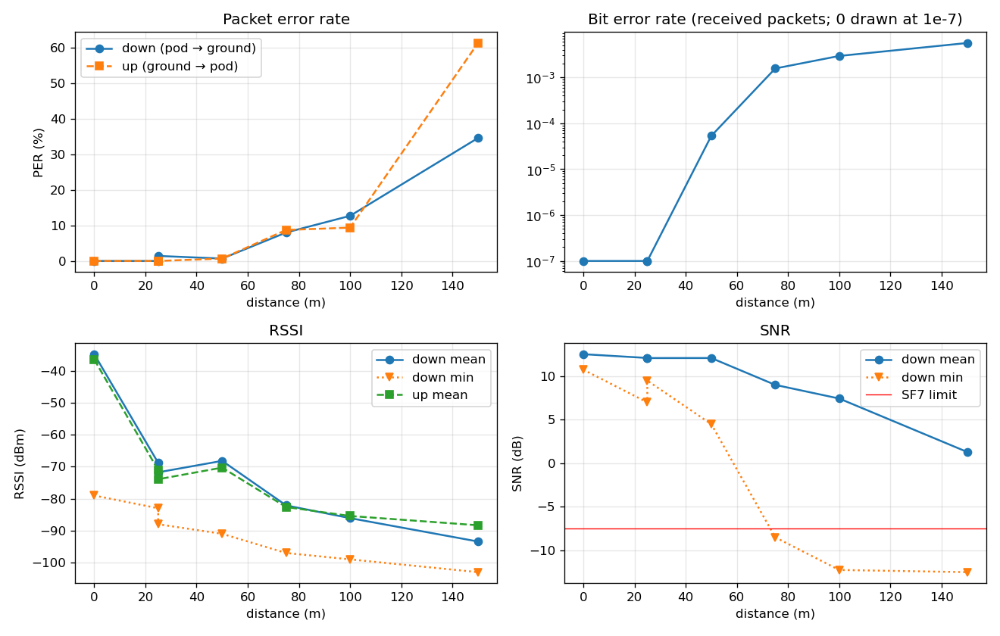
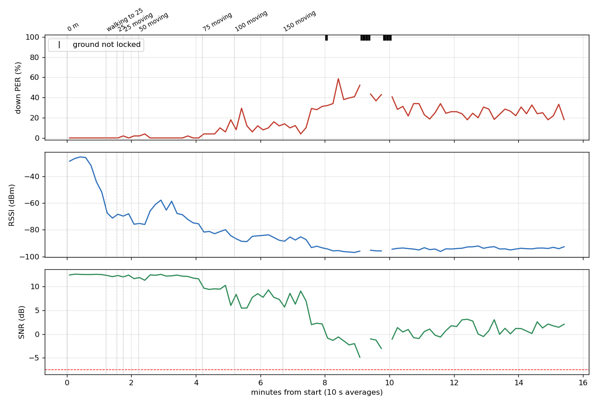

# Range test report

Texas Guadaloop RF comms, FHSS link between the pod and ground boards. Generated by `tools/range/range_report.py` from the logs listed at the end.

## Summary

**First range test, 2026-11-14, Zilker Park (Austin).**

| | |
|---|---|
| Setup | Both boards about 1 m high, stock shield antennas vertical, 14 dBm, LoRa SF7 / 125 kHz, 330/70 slot split |
| Ground | On the laptop over USB, logging |
| Pod | On a USB power bank, carried out on foot |

| Range | Pod → ground (telemetry) | Ground → pod (commands) | Link |
|---|---|---|---|
| 0–50 m | **≤ 1 % packet loss**, BER ≤ 6e-5 | ≤ 1 % loss | Locked throughout |
| 75–100 m | **8–13 % loss**, BER 2–3e-3 | ≈ 9 % loss | Locked throughout |
| 150 m and beyond (distance not recorded after 150 m) | First minute 15 %, then **25–60 %** | 61 % loss over the stop | Lost lock 3 times in minutes 2–4, each regained within 4–18 s, then held |

**Findings**

1. **Range was limited by noise, not by signal level.**
   - At 150 m and beyond, packets arrived at about −94 dBm with SNR near 0 dB. The noise in the channel was therefore about −95 to −99 dBm at the ground (estimated in the table below).
   - The SX1262 should see about −117 dBm (thermal noise plus its noise figure) and decode down to about −124 dBm at SF7.
   - So the signal still had about 30 dB to spare, but noise about 20 dB above normal used it up.
   - The pod side was worse: its commands arrived at −88 dBm with SNR around −5 dB (noise about −89 dBm), which is why commands up were lost more often than telemetry down.
2. **No single bad channel.**
   - CRC failures were spread across all 50 channels: 5–33 % each, where chance alone gives about 10–31 %.
   - Failed packets had a median SNR of −0.5 dB, against +4.5 dB for good ones.
   - That fits fading plus a high noise floor, not one interferer or a timing problem.
3. **Bit errors only appear once packets start failing.**
   - BER was 0 in 377,152 bits checked up to 25 m (under 1e-5), and 18 errors in 714,544 bits up to 50 m (2.5e-5), all in the 5 packets that failed the CRC.
   - When a packet fails, the errors are few: median 6 bits wrong of 568.
   - So stronger error correction (coding rate 4/8 instead of 4/5) or a higher spreading factor would recover many of the failed packets, at the cost of airtime.
4. **The firmware held up at the edge of range.**
   - After each loss of lock the ground relocked within 4–18 s, against up to 20 s by design.
   - The pod kept sending 2 frames every hop (about 5/s) throughout.

**Likely noise sources, to check next**

The ground board was powered from the laptop's USB port during the test (team note, 11-15), so the laptop is the most likely source of the ground-side noise. It doesn't explain the pod side: the pod was on a power bank far from the laptop, yet its noise (about −89 dBm) was worse than the ground's (−95 to −99 dBm).

| Suspect | Side | Why | Test |
|---|---|---|---|
| **Laptop USB power and the laptop itself** | Ground | Ground radio was powered from, and sitting next to, the laptop: a common source of broadband noise | Power the ground board from a battery or a USB isolator, antenna on a cable 2 m from the laptop; repeat the noise scan |
| Power bank switching noise | Pod | Pod-side noise was the worst | Pod on a different battery, or a linear supply |
| MCU clock | Both | It went from 4 to 48 MHz just before this test. 19 × 48 MHz = 912 MHz, inside the band, and the worst channel was 912.7 MHz. The self-test noise scan on the bench was −102 dBm average at 48 MHz (11-14) against −111 dBm at 4 MHz (10-04). | Noise scan (self-test) at 4 and 48 MHz in the same place |
| Ambient 915 MHz traffic | Both | Smart meters, RFID, LoRaWAN | Brennen's SDR sweep of 902–928 MHz at the test site |

**Next tests**
- Repeat after the noise checks above.
- Then try 22 dBm, raise both antennas to about 2 m, and record the distance at every stop (a phone GPS pin works).

## Setup

- `range_171518.log`: field test 2026-11-14 at Zilker Park (Austin), 14 dBm both boards, SF7/125 kHz, stock shield antennas vertical, both boards ~1 m high

| Parameter | Value |
|---|---|
| Radios | 2 × Semtech SX1262 (SX1262MB2xAS shield) on NUCLEO-WL55JC2 |
| Modulation | LoRa SF7, 125 kHz, CR 4/5, 8-symbol preamble, explicit header, CRC on |
| Hopping | 50 channels 902.2–926.7 MHz, 500 kHz apart, 400 ms per channel |
| TX power | ? dBm (both boards) |
| Pod → ground | 77 B test payload + 6 B link header = 83 B, 149 ms on air, pod slot ? ms of each 400 ms hop |
| Ground → pod | one test command per hop (fills the ground's slot) |
| SX1262 sensitivity (datasheet) | -124 dBm; demodulation SNR limit -7.5 dB at SF7 |

## Results

Pod → ground ("down") is the telemetry direction. Intervals in brackets are 95 % confidence.

| Stop | Time | Locked (lost) | Down: sent / ok / CRC fail | Down PER | BER (received packets) | RSSI mean (min) | SNR mean (min) | Noise floor | Margin | Up: sent / ok | Up PER | Up RSSI / SNR |
|---|---|---|---|---|---|---|---|---|---|---|---|---|
| 0 m, Zilker Park, both boards ~1 m high | 73 s | 100 % (0×) | 365 / 365 / 0 | 0.0 % (0.0–1.0) | 0 errors in 207,320 bits (< 1.8e-05) | -35 (-79) dBm | 12.5 (10.8) dB | – dBm | 19.5 dB | 182 / 182 | 0.0 % (0.0–2.1) | -36 dBm / 12.4 dB |
| walking to 25 | 20 s | 100 % (0×) | 100 / 100 / 0 | 0.0 % (0.0–3.7) | 0 errors in 56,800 bits (< 6.5e-05) | -70 (-87) dBm | 12.2 (9.2) dB | – dBm | 19.2 dB | 49 / 49 | 0.0 % (0.0–7.3) | -72 dBm / 9.3 dB |
| 25 | 12 s | 100 % (0×) | 59 / 59 / 0 | 0.0 % (0.0–6.1) | 0 errors in 33,512 bits (< 1.1e-04) | -69 (-83) dBm | 12.1 (7.0) dB | – dBm | 18.7 dB | 29 / 29 | 0.0 % (0.0–11.7) | -71 dBm / 9.0 dB |
| 25 moving, continuous walk out | 28 s | 100 % (0×) | 141 / 139 / 1 | 1.4 % (0.4–5.0) | 0 errors in 79,520 bits (< 4.6e-05) | -72 (-88) dBm | 12.1 (9.5) dB | – dBm | 18.8 dB | 70 / 70 | 0.0 % (0.0–5.2) | -74 dBm / 9.3 dB |
| 50 moving | 118 s | 100 % (0×) | 594 / 590 / 4 | 0.7 % (0.3–1.7) | 5.3e-05 (3.2e-05–8.4e-05) | -68 (-91) dBm | 12.1 (4.5) dB | – dBm | 18.8 dB | 296 / 294 | 0.7 % (0.2–2.4) | -70 dBm / 9.8 dB |
| 75 moving | 60 s | 100 % (0×) | 300 / 276 / 21 | 8.0 % (5.4–11.6) | 1.6e-03 (1.4e-03–1.8e-03) | -82 (-97) dBm | 9.0 (-8.5) dB | -94 dBm | 12.4 dB | 149 / 136 | 8.7 % (5.2–14.4) | -83 dBm / 3.0 dB |
| 100 moving | 90 s | 100 % (0×) | 449 / 392 / 56 | 12.7 % (9.9–16.1) | 2.9e-03 (2.7e-03–3.2e-03) | -86 (-99) dBm | 7.4 (-12.2) dB | -96 dBm | 9.5 dB | 224 / 203 | 9.4 % (6.2–13.9) | -85 dBm / 0.4 dB |
| 150 moving | 523 s | 93 % (3×) | 2619 / 1713 / 530 | 34.6 % (32.8–36.4) | 5.6e-03 (5.5e-03–5.8e-03) | -93 (-103) dBm | 1.3 (-12.5) dB | -99 dBm | 1.5 dB | 1215 / 470 | 61.3 % (58.5–64.0) | -88 dBm / -4.9 dB |

## Long stops, minute by minute

**150 moving** (523 s):

| Minute | Down: sent / ok | Down PER | RSSI mean | SNR mean | Locked |
|---|---|---|---|---|---|
| 1 | 297 / 254 | 14.5 % | -88 dBm | 6.3 dB | 100 % |
| 2 | 298 / 171 | 42.6 % | -95 dBm | 0.2 dB | 93 % |
| 3 | 299 / 114 | 61.9 % | -96 dBm | -2.3 dB | 70 % |
| 4 | 297 / 140 | 52.9 % | -94 dBm | 0.1 dB | 73 % |
| 5 | 299 / 208 | 30.4 % | -95 dBm | -0.2 dB | 100 % |
| 6 | 299 / 226 | 24.4 % | -94 dBm | 2.2 dB | 100 % |
| 7 | 299 / 221 | 26.1 % | -93 dBm | 0.8 dB | 100 % |
| 8 | 300 / 216 | 28.0 % | -94 dBm | 1.1 dB | 100 % |
| 9 | 218 / 163 | 25.2 % | -94 dBm | 1.6 dB | 100 % |

## CRC failures by channel

Stops with 5 % or more CRC failures (75 moving, 100 moving, 150 moving): 2988 packets received on 50 channels, 20 % failed the CRC. With about 60 packets per channel, pure chance spreads that over roughly 10–31 %.

| | Channels (MHz, share failed) |
|---|---|
| Worst 5 | 912.7 (33 %), 925.7 (32 %), 926.7 (31 %), 907.7 (29 %), 915.7 (28 %) |
| Best 5 | 920.2 (12 %), 916.7 (11 %), 919.2 (9 %), 905.7 (5 %), 906.2 (5 %) |

## How each number is measured

- **Sent:** from the pod's transmit counter in the packets that passed the CRC (last − first + 1 at that stop), so packets lost before the first or after the last good one aren't counted.
- **Down PER:** 1 − (packets that passed the CRC ÷ sent). Covers both packets never detected and packets that failed the CRC. 95 % interval: Wilson score.
- **BER:** the pod fills each packet with a known PRBS-9 pattern seeded by the hop index; the ground regenerates it and counts wrong bits in every packet it received, including those that failed the CRC (568 bits checked per packet). Packets never detected aren't in the BER (they're in the PER). 95 % interval: exact Poisson; with 0 errors the upper bound is ~3 ÷ bits.
- **RSSI / SNR:** the SX1262's packet status for every received packet (SNR in 0.25 dB steps).
- **Margin:** 10th-percentile SNR at that stop minus the SF7 demodulation limit (-7.5 dB): how much more path loss the link could take with 90 % of packets still above the limit.
- **Noise floor:** median over the stop of RSSI − 10·log10(1 + 10^(SNR/10)), the noise plus interference in the 125 kHz channel at the ground, from packets with SNR ≤ 8 dB (the SX1262’s SNR reading saturates near +12 dB, so stronger packets can’t show the noise; "–" means the signal was too strong to tell). Thermal noise plus the SX1262 noise figure is about −117 dBm, so a higher value means local noise or interference is setting the range rather than the signal level.
- **Up:** the ground sends one command per hop; the pod counts the ones it receives and reports the count, plus the last command's RSSI/SNR, inside its packets. Up PER = 1 − (received ÷ sent) over the stop (the pod's count lags by up to one hop).
- **Locked:** share of the ground's once-a-second status lines that showed it locked to the pod's hopping; (n×) is how many times it lost lock during the stop.

Raw data: `range_171518.log`; per stop in `stops.csv`, every packet in `packets.csv`.
